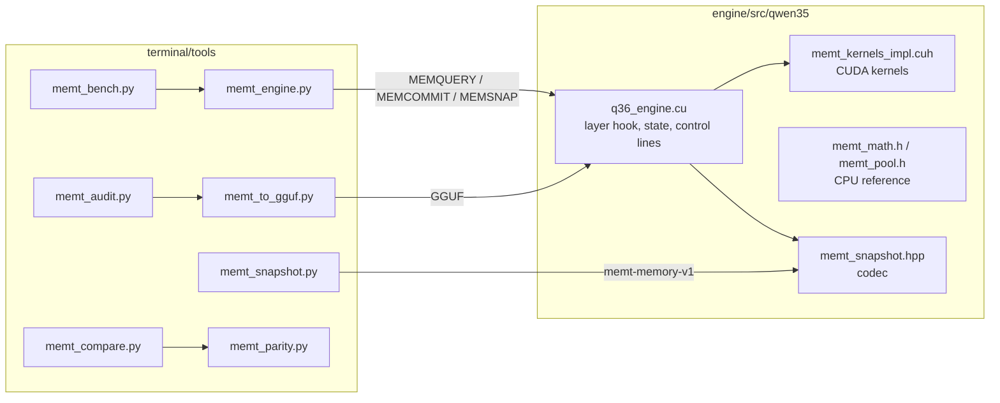
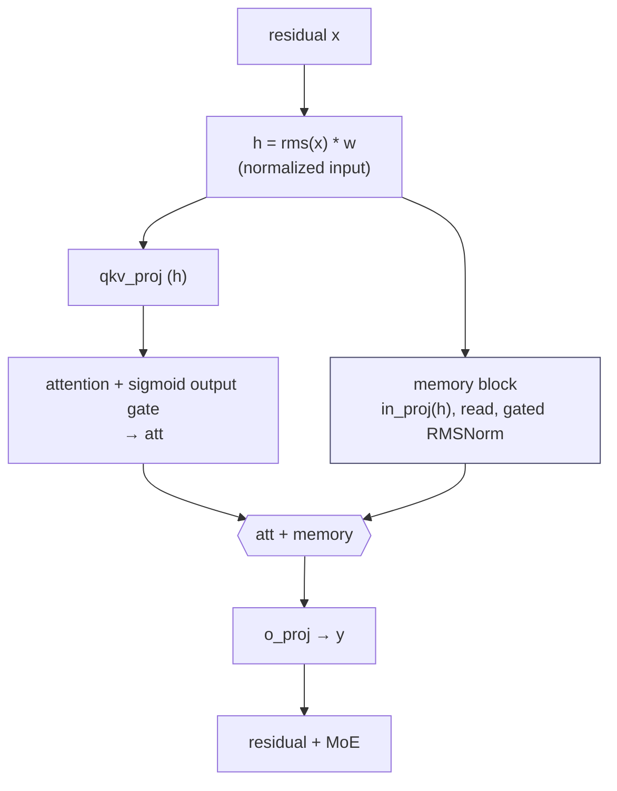
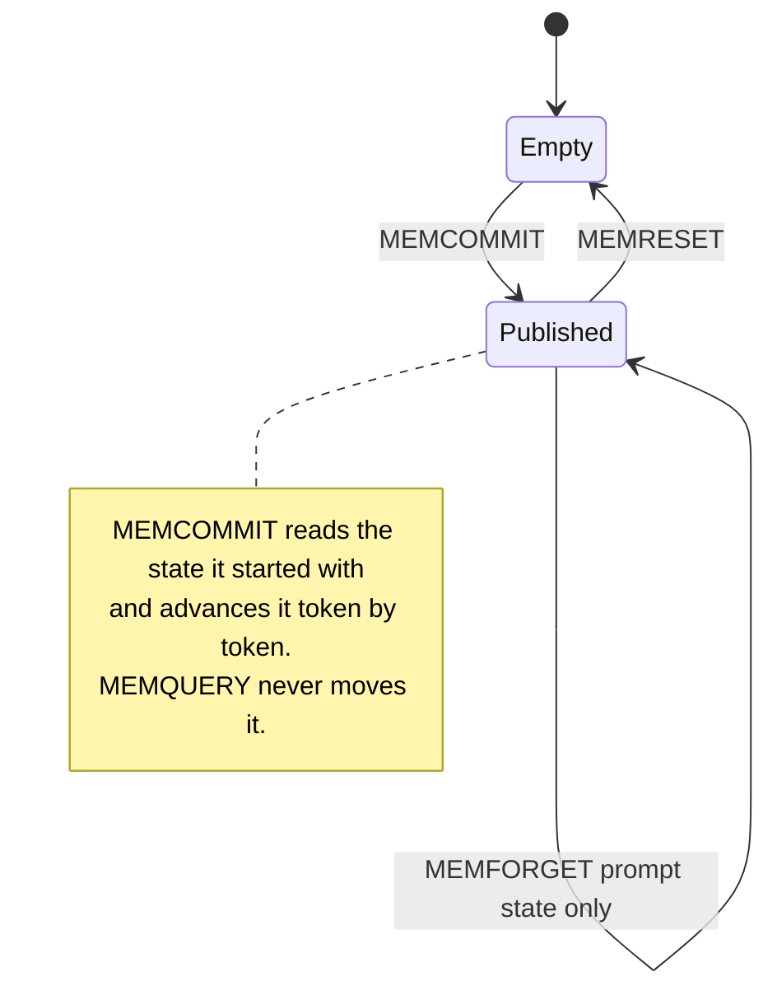
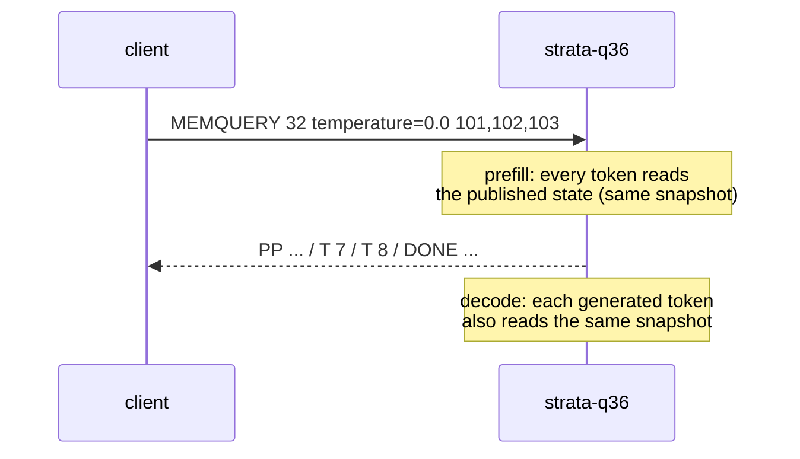
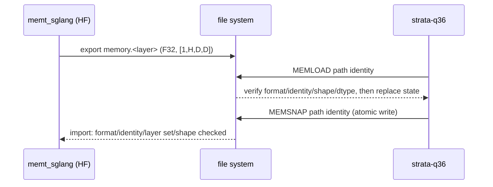

# MemT-1.0-Nano on Strata — design, semantics and verification

This document is self-contained: it says what MemT-1.0's Native Memory Block is,
how it was ported into Strata's `qwen35moe` C++/CUDA engine (`strata-q36`), what
the on-disk formats are, what has been *verified* and what has not, and where the
performance limits are. It assumes no prior reading.

> **Status.** The whole scope of this document is implemented and checked on a
> CPU machine (154 C++ test binaries — one of them, `memt_pool_test`, runs 186 checks — and 218 Python tests, the serving paths included,
> multi-
> round independent review). The CUDA path has **never been compiled or run** —
> the porting machine has no NVIDIA GPU and no `nvcc`. Gates P6 (numerical parity
> with `memt_sglang`) and P7 (same-card tok/s, TTFT, TPOT) are open, and so is
> the first GPU run of the fork's own `--batch` / `--mtp` / server-write paths.
> Nothing in this document should be read as a runtime or speed claim.

---

## 1. Scope

In scope: **MemT-1.0-Nano only** — a Qwen3.6-35B-A3B hybrid backbone plus the
release's memory block — on the `qwen35moe` path of the fork. Out of scope:
MemT-Flash / Pro, vision, training, SGLang source patches (§2.4), Mixture-of-
Storage (§2.4, described in the report, not released), and upstreaming to
Strata.

The base is Strata (`llama.cpp`/`ggml`-style C++/CUDA engine, not SGLang). The
fork adds a memory tensor set, a per-session FP32 store, a read/write path inside
`Engine::layer()` (including the batch row windows and MTP verify windows), six
control lines, a snapshot codec, and a write per completed turn in the HTTP
server.

---

## 2. What the model is

### 2.1 Backbone (MemT-1.0-Nano)

| Field | Value |
| --- | --- |
| Architecture | Qwen3.6-35B-A3B hybrid (`qwen35moe`) |
| Hidden / layers | 2048 / 40 |
| Attention | 16 query heads, 2 KV heads, head_dim 256, output gate fused into `q_proj` (`[8192, 2048]`) |
| Full-attention interval | every 4th layer; the other layers are gated delta-net (GDN) |
| MoE | 256 experts, top-8, expert FF 512, shared expert FF 512 |
| Vocab | 248320 |
| Memory layers | `3, 7, 11, …, 39` (10 layers) |

The backbone behaviour is unchanged from Strata's existing qwen35moe path; the
Memory Block is additive.

### 2.2 The Native Memory Block

Each of the 10 full-attention layers owns a **persistent FP32 state**
$S \in \mathbb{R}^{H \times D \times D}$ with $H = 16$, $D = 256$ — 4 MiB per
layer, 40 MiB per session. Unlike a KV cache it is not derived from the current
conversation and it is not reset by a new prompt.

Six tensors per memory layer (HF names under `model.language_model.layers.<i>.self_attn.memt.`):

| Tensor | Shape | Role |
| --- | --- | --- |
| `in_proj.weight` | `[20992, 2048]` | one projection whose rows are, in order: `q`, `k`, `v`, `erase_raw`, `write_raw`, `decay_latent`, `og_latent` |
| `f_down.weight` | `[4096, 256]` | decay latent ($R{=}256$) → per-(head, channel) decay |
| `g_down.weight` | `[4096, 256]` | output-gate latent → per-(head, channel) gate |
| `decay_scale_log` | `[16]` | per-head decay scale |
| `decay_bias` | `[4096]` | per-(head, channel) decay bias |
| `o_norm.weight` | `[256]` | gated RMSNorm weight (shared across heads) |

**Per token, per memory layer** (all row counts below are per token):

$$
\begin{aligned}
q,k,v,\;e_{\text{raw}},w_{\text{raw}},d_{\text{lat}},g_{\text{lat}} &= \operatorname{in\_proj}(h) \\
\text{erase} &= \exp\!\big(\tfrac12 \log\sigma(e_{\text{raw}})\big) \in (0,1] \\
\text{write} &= \sigma(w_{\text{raw}}) \in (0,1) \\
g &= -\exp(\text{decay\_scale\_log}[\text{head}]) \odot \mathrm{softplus}\big(f_{\text{down}}(d_{\text{lat}}) + b\big) \quad (< 0) \\
o &= g_{\text{down}}(g_{\text{lat}})
\end{aligned}
$$

Read (against a **fixed snapshot** $\hat S$):

$$
\hat q = \frac{q}{\lVert q\rVert}, \qquad
r = D^{-1/2}\, \hat q\, \hat S, \qquad
\mathrm{out} = \mathrm{RMSNorm}_{\mathrm{gated}}(r;\; o, w_{o})
$$

where the gated RMSNorm is per (token, head) over $D$ with
$\text{gate} = L \tanh(\operatorname{silu}(o)/L)$, $L = 2.0$ (softcap).

Write (stable GDN-2 delta rule), with $\hat k = k/\lVert k\rVert$ and
$k_{\text{eff}} = \mathrm{erase} \odot \hat k$:

$$
S \leftarrow \mathrm{diag}(\exp g)\, S, \qquad
\Delta = \mathrm{write} \odot v - S^{\top} k_{\text{eff}}, \qquad
S \leftarrow S + k_{\text{eff}}\, \Delta^{\top}
$$

The write gate multiplies the **value only** — the WY form is
$u = A(\text{write}\odot v)$, $w = A(k_{\text{eff}})$, $v_{\text{new}} = u - wS$,
whose per-token form is the equation above (`A` is the intra-chunk WY transform;
it changes summation order, not the result).

### 2.3 How this differs from a plain LLM

1. A per-layer, per-session **persistent state** that survives prompt resets and
   spans requests.
2. Reads use the state **as of the request's start** for *every* token of that
   request; the state advances only on commit.
3. The write is a **delta-rule update** with two gates and a per-head decay,
   not attention.
4. **Commit and query are separate requests**: commit writes without generating;
   query generates without writing.
5. The state is **exportable** (`memt-memory-v1`) and belongs to no transcript.
6. Only the 10 full-attention layers carry memory.

### 2.4 Mixture-of-Storage: described, not released, not implemented

MemT-1.0's technical report (§2.3, *Mixture-of-Storage, MoS*) describes a
memory layer that keeps **$E$ parallel storage experts per layer**, each with
its own state $S_e \in \mathbb{R}^{H \times d_k \times d_v}$, a dense router
$W_{\text{route}} \in \mathbb{R}^{d \times E}$ (with a bias $u$), a softmax
over the experts, and a weighted fusion of the experts' readouts. The per-turn
write would then apply to every expert (weighted), and the read would be the
router-weighted sum. It is presented there as a way to scale memory *capacity*
with the number of experts, at the cost of $E$ times the state and $E$ times
the read/update work per query and commit.

**What the release actually contains.** Nothing of MoS: no `mos_*` / storage-expert
code in `memt_sglang/`, no router tensor, no config field, and no weights —
Nano's checkpoints carry exactly six `memt.*` tensors per memory layer (§2.2)
and one state per layer. Searching the inference package and the released
configs for "storage expert", "route", "expert" finds only the backbone's
MoE. So MoS is a *design in the report*, not a runnable mechanism, and there
is no reference output to check a port against.

**Why this fork does not implement it.** Not because it is hard to write — it
is a loop over $E$ states plus a router — but because everything that makes
an implementation *right* is missing:

1. **No reference numerics.** The report gives the architecture, not the
   initialization, the router's training, the decay/gate treatment per expert,
   or how a commit distributes a token's write across experts. Every one of
   those choices changes the readout; guessing them would produce a memory
   block that runs but does not reproduce the paper's model.
2. **No weights or config to validate against.** Nothing here can be run on
   a released checkpoint, so even the geometry ($E$, $d_k$/$d_v$ per expert,
   router width) is unknown — a converter could not build a valid GGUF.
3. **No GPU to measure the cost.** $E$ times the state and the work is the
   whole point of the trade-off; without a GPU the design's (and the model's)
   promise cannot be checked at all.
4. **A wrong memory silently poisons every later answer**, which is worse than
   a missing feature: a reader cannot tell a MoS-misconfigured bank from a
   trained one by looking at its output.

The code therefore *refuses* MoS-shaped input instead of approximating it:
the converter's audit validates the `memt` section with an **exact field set**
(`terminal/tools/memt_audit.py`, `MEMT_FIXED`), so a config carrying, say,
`memt.num_storage_experts` or `memt.storage_router_dim` fails loudly
(`test_memt_audit.py::test_a_mixture_of_storage_field_is_refused`), and the
engine's geometry check refuses a GGUF whose `memt.*` metadata does not match
what one state per layer means. **The precondition to implement MoS is a release
that ships the code, the config fields and the weights (or a paper appendix
with the exact equations): then the memory block above generalizes to
$E$ states per layer, the router becomes one more FP32 matmul per token, and
the snapshot format gains an expert dimension — all of it checkable against
the reference on the same GPU.**

**The release's `patches/` are not needed either.** `decode-owners` serves Flash's
memory decode graph, `stable-topk` is an optional selection policy, `dsv4-numerics`
is Flash's strict tier. Nano's decode graph runs without a patch. What *is*
model-specific for Nano is the SGLang-side integration — a model class plus two
layer hooks — and that integration is what was ported into the C++ engine (§3).

---

## 3. Integration into Strata

### 3.1 Where the code lives



| Layer | File | Purpose |
| --- | --- | --- |
| Metadata | `engine/include/strata/core/family_layout.hpp` | read/validate `memt.*`, add six tensors per attention layer |
| Geometry | `engine/include/strata/core/geometry.hpp` | `memt_heads/head_dim/gate_rank/chunk/eps/softcap` |
| Kernels | `engine/src/qwen35/memt_kernels{,_impl}.cuh` | gates, latents, key, read, update |
| Wiring | `engine/src/qwen35/q36_engine.cu` | load, state, `memt_layer()`, control lines |
| CPU reference | `engine/src/qwen35/memt_math.h`, `memt_pool.h` | scalar oracle for the tests |
| Codec | `engine/include/strata/qwen35/memt_snapshot.hpp` | `memt-memory-v1` read/write |
| Converter | `terminal/tools/memt_to_gguf.py` | HF → GGUF |
| Audit | `terminal/tools/memt_audit.py` | config/tensor check without weights |
| Client | `terminal/tools/memt_engine.py` | line protocol + identity |
| Harnesses | `memt_parity.py`, `memt_bench.py` | P6, P7 |

### 3.2 The per-layer dataflow, and the two facts that matter

`Engine::layer()` runs: mix attention (or GDN) on the normalized input `h`,
inject, project, residual, MoE. The memory block sits between the attention
output and `o_proj`:



Two facts were verified line by line against the release's
`models/qwen/integration.py` (comments: *"qkv input is normalized hidden;
o_proj input already includes the native sigmoid attention gate"*):

1. **Input**: SGLang hooks `qkv_proj`'s pre-hook, so the memory sees the
   *normalized* hidden. In Strata, `h` entering the layer is already
   `rms(prev) * post_norm` and `prep_in()` only quantizes it
   (`prep()` = `quant`/`k_to_f16`, no norm). `memt_layer()` therefore calls
   `prep(h)`, i.e. the same tensor. ✅
2. **Injection**: SGLang hooks `o_proj`'s pre-hook with `att + residual`. In
   Strata the `att` written by `k_attn_merge(..., gate, ...)` already carries the
   sigmoid attention gate, and `memt_layer()` adds into it right before
   `mm(L.wo, att, y, T)`. ✅

Scratch safety: `memt_layer()` re-quantizes `h` into the shared `xq` image after
attention has consumed it; the MoE always re-quantizes (`if (!xq_post) quant(...)`)
or uses the image written by `k_add_rms_q`, so the overwrite cannot leak. This
was checked by tracing every `xq_ready` / `xq_post` use.

### 3.3 Loading

`geometry_from_gguf` refuses a MemT file unless `memt.version == 1`,
`memt.head_count == attention.head_count`, `memt.head_dim == key_length`,
`memt.gate_rank == head_dim`, all floats finite and positive, and
`memt.memory_layers` (when present) equals the layers selected by
`full_attention_interval`. The six tensors are added to the layout table for
`LayerKind::Attention` only; `q36ref` (the reference-implementation path)
refuses MemT files.

`memt.in_proj` is Q8_0 like the backbone (it is a real matmul); `f_down`,
`g_down`, `decay_*`, `o_norm` stay F32. The engine's MMVQ path has no F16/BF16
matmul, and keeping the gates F32 avoids feeding quantized gates into the decay.

### 3.4 State, and several sessions

`Engine::Sess` holds `memt_state[li]` (4 MiB/layer) and a lazily allocated
`memt_snap[li]` (the commit's frozen read copy) — i.e. the memory is **per
session**, exactly like the GDN recurrence and the K/V cache next to it:
`alloc_session()` allocates it for every `Sess`, `select()`/`load_cur()` swap
the pointer vectors, and a session's memory is its own store. `reset()` — a new
prompt in that session — keeps the memory; `MEMRESET` zeroes it; `MEMLOAD`
replaces it.

Consequences of the per-session layout (this fork's `--batch` / `--mtp` work):

| Mode | How the memory runs | Notes |
| --- | --- | --- |
| one session (`--batch 1`) | one pass per forward, tiled at 256 tokens | the plain path; the HTTP server writes in every engine that serves one request at a time (a one-session engine, and each replica of a pool) |
| `--batch N` | a row window is a **query**: each row reads the memory of its own session (`hrow`'s row-slot table, the same table the GDN kernels read) | CUDA graphs are switched off for such an engine (a captured graph would bake one session's state pointer); 40 MB of state per session + 40 MB per commit snapshot |
| `--mtp N` (one session or `--batch`) | a verify window is a query: in one session all its rows read the same pre-call snapshot, which is exactly the documented per-call semantics; with `--batch` each row reads its own slot's state | commits never run inside a verify window (they are their own control request, with the engine idle) |

`mem_request` still requires an **idle** engine: a memory control changes the
state a decoding slot is reading. `MEMSELECT <session>` makes the following
control lines (`MEMCOMMIT`, `MEMSNAP`, `MEMLOAD`, `MEMRESET`, `MEMFORGET`) act
on that session (a one-session engine's is 0); `MEMQUERY` is a request and picks
its own session (`pick_session`), so the selection matters only until the next
request. A `--batch` engine's slots are read by their requests and written
only by such an explicit control line.

The HTTP server (§8) writes when the turn's engine can take a commit: one
engine with a single request at a time (the plain path, and each replica of a
pool - while that replica's run lock is held), not an engine that runs several
requests at once (`--parallel`, or replicas with slots). Each engine process
has a bank of its own, empty when it starts, and the server tracks one
`[generation, tokens]` pair per engine, so a turn served by another replica is
written to that replica's bank (with *its* prefix), and a restarted replica's
empty bank takes the whole conversation again.


---

## 4. Semantics

### 4.1 The session state machine



### 4.2 A query



### 4.3 A commit

```mermaid
sequenceDiagram
    participant C as client
    participant E as strata-q36
    C->>E: MEMCOMMIT 101,102,103
    E->>E: reset prompt state (keep memory)
    E->>E: freeze: snap = copy(state)
    loop each token (tiles of 256)
        E->>E: read from snap; update state
    end
    E-->>C: MEMDONE 3 3 12.5
    Note over E: prompt state is dropped: a later<br/>query re-reads its prompt
```

### 4.4 Snapshot round trip



### 4.5 Invariants

| # | Invariant | Enforced by |
| --- | --- | --- |
| I1 | A query never changes the state | `read_state` is `const`; `write_state == nullptr` unless committing; tested |
| I2 | Every token of a commit reads the state at the call's start | freeze in `memt_commit_begin()`; tested (read == query of start state) |
| I3 | The final state does not depend on write-event size or call boundaries | the update never reads its own output; tested over random cases |
| I4 | A query's reads *do* depend on call boundaries (each call freezes its own snapshot) | by design; tested |
| I5 | `MEMLOAD` replaces, never merges; an empty snapshot zeroes | validate-then-copy; tested |
| I6 | `MEMFORGET` drops prompt state (KV/GDN/checkpoints) but not memory | `memt_forget_state()`; tested |
| I7 | A snapshot is only read if format, identity, layer set, shape and dtype match | both codecs; tested |
| I8 | Memory never runs in a batched row window | startup refusals + `memt_layer` guard |
| I9 | `memt.*` metadata cannot contradict the backbone | metadata checks; tested |
| I10 | Identity covers backbone config + memory config + codec + chat template + vocab | `snapshot_identity`; cross-checked |

---

## 5. Formats

### 5.1 GGUF

Metadata (`u32` unless noted): `memt.version` = 1, `memt.head_count`,
`memt.head_dim`, `memt.gate_rank`, `memt.chunk_tokens` = 2048,
`memt.full_attention_interval`, `memt.output_gate_softcap_limit` (f32),
`memt.rms_norm_epsilon` (f32), `memt.memory_layers` (array), and optionally
`memt.identity` (string: 64 hex characters, the `memt-memory-v1` identity of
§5.4, written by the converter when the checkpoint directory has the chat
template and the tokenizer). The engine prints it as `INFO memt_identity=<hex>` before `READY`;
without it the file loads and runs, and the snapshot route has no identity to
compare against.

Tensors per memory layer `<i>`: `blk.<i>.memt.in_proj.weight` (Q8_0),
`f_down.weight`, `g_down.weight`, `decay_scale_log`, `decay_bias`,
`o_norm.weight` (all F32).

### 5.2 Converter

HF → GGUF applies the same transforms as the rest of the backbone (qkv/z/a/b row
merges, gate/up split, kv-head replication, conv squeeze and V reordering) and,
for memory, copies the six tensors into `blk.<i>.memt.*`. The audit prints every
transform and validates the layout table without weights; a checkpoint whose
config selects different maths (e.g. a non-SILU gate) is rejected because the
`memt` object is matched field by field.

### 5.3 `memt-memory-v1`

A safetensors file:

```
[8 bytes LE: header length][header JSON, space-padded to 8][data]
header = {
  "__metadata__": {"format": "memt-memory-v1", "identity": "<sha256>"},
  "memory.3": {"dtype": "F32", "shape": [1,16,256,256], "data_offsets": [0, 4194304]},
  ...
}
```

An empty memory is a valid file with no tensors. Writers are atomic (temp file +
`fsync` + rename, symlink refused); readers validate every field before touching
state. The C++ and Python writers are byte-identical (a fixture pins it).

### 5.4 Identity

```
sha256( json({"backbone": <backbone config>, "memt": <memt object>,
              "codec": "qwen-text-raw-v1",
              "template": <chat template>, "vocabulary": <token -> id>},
             sort_keys=True, ensure_ascii=True) )
```

`memt_parity.py` takes it from the reference server's
`GET /memt/capabilities`; `MEMLOAD`/`MEMSNAP` compare the string they are given.
`identity_from_model_dir()` recomputes it from a checkpoint directory as a
best effort (it rebuilds the vocabulary from `tokenizer.json`; the server's
reported value is authoritative). The converter stores it in the GGUF
(`memt.identity`, optional), the engine reports it (`INFO memt_identity`), and
the server's snapshot route (§8.1) passes it to `MEMSNAP`/`MEMLOAD` — so a
snapshot is only accepted by a model with the same identity (backbone config,
memory config, codec, chat template, vocabulary; **not** the weights, which the
identity does not cover), while the reference server stays the authority for
parity runs.

---

## 6. Verification

### 6.1 What is checked on a CPU machine

| Property class | Where | Scale |
| --- | --- | --- |
| Config/schema audit against the real 753-tensor header; MoS fields refused | `test_memt_audit` | 24 tests |
| Scalar recurrence vs an independent NumPy oracle | `test_memt_cpu_math`, `memt_cpu_test` | 11 tests, max diff ~1e-7 |
| Kernels recompiled host-side vs the scalar reference (index math, strides, reductions) | `memt_kernels_cpu_test` | 9 checks |
| Session semantics (I1–I6) incl. **randomised properties**, chunk invariance and the two row windows (a `--batch` window's rows read their own sessions; a verify window's rows read one snapshot) | `memt_pool_test` | 186 checks |
| Bounded model check over all query/commit sequences of length ≤ 4 | `test_memt_session_flow` | 31 sequences |
| Snapshot codec, both languages, byte equality, safety | `memt_snapshot_test`, `test_memt_snapshot` | 24 + 13 tests |
| Converter transforms + layout table + `memt.identity` | `test_memt_to_gguf` | 21 tests |
| Metadata rejection (bad heads, NaN softcap, layer set, non-hex identity) | `q36_metadata_test` | 37 checks |
| Control-line client, P6/P7 procedures, reference driver | `test_memt_engine`, `memt_parity`, `memt_bench`, `memt_ref` | 21/16/15/19 tests |
| Serving writes: `READY ... memt`, the per-turn `MEMCOMMIT` exchange, delta/skip/refused/silent paths, tool and cap turns, over HTTP | `terminal/serve/test_memt_turns.py` (a fake engine behind the real `StrataEngine` and `Service`, replicas included) | 59 tests |
| Memory state route: `POST /v1/memt` status/reset/save/load, sidecar prefix, name/symlink/identity refusals, replicas and slots | `terminal/serve/test_memt_turns.py` (`MemoryState`, `MemoryRoute`) | included above |

The randomised property test is worth calling out: it generates states, gates and
decay for 12 geometries, then asserts I2–I4 plus finiteness. It immediately
exposed an incorrect first draft of the property itself (call boundaries change
*reads*, not the state), which is exactly the confusion the property is meant to
prevent.

### 6.2 What is *not* verified

- **Compilation** of `q36_engine.cu`, `memt_kernels.cu` and the codec header on a
  CUDA toolchain. A syntax or type error would only surface on the first GPU
  build.
- **Any runtime behaviour**: loading a real GGUF, VRAM sizing, graph capture,
  numerics.
- **The fork's new runtime paths**: the per-row memory pass of a `--batch` row
  window (each row's session state), the per-session `select()` swap and the
  MTP verify window's reads are compiled code, reviewed line by line, but they
  have never run on a GPU; likewise the server's `MEMCOMMIT`,
  `MEMRESET`/`MEMSNAP`/`MEMLOAD` and `POST /v1/memt` exchanges have only met a
  fake engine (the protocol tests), not the real one.
- **P6**: that the FP32 state and the generated tokens match `memt_sglang`.
- **P7**: tok/s, TTFT, TPOT.

Those are the two open gates; `memt_parity.py` and `memt_bench.py` are the
instruments, already tested against stub servers. P6 must now also be run once
per session mode (one session; `--batch 2` with two conversations) so the
per-session state is checked against the reference and not only against this
fork's own CPU reference.

### 6.3 Known-weak spots (reviewed, accepted)

| Spot | Why it is accepted |
| --- | --- |
| Q8_0 `in_proj` vs BF16 reference | the whole backbone is Q8_0; the state stays F32. The tolerance is agreed from measured P6 numbers. |
| FP32 read/update vs BF16 Triton | strictly more accurate; differences are bounded by the backbone quantization anyway. |
| `rel_l2`/cosine bounds are ceilings | defaults (0.999 / 0.25) catch gross errors; the real tolerance is agreed after a GPU run. |
| VRAM estimate excludes ~110 MiB of state+scratch | only matters on a card that is within 110 MiB of full. |
| `identity_from_model_dir` reconstruction | the server's value is used by default; the check is opt-in. |
| Snapshot sidecar | the memory file carries the identity, not the token prefix; the server writes `file.json` beside it, bound to the snapshot's SHA-256 (a copy, an interrupted save or a failed sidecar write makes the pair disagree). A snapshot without a matching sidecar loads and holds its tokens, but no turn extends it (the bank is sealed), so it is read-only until a reset (§8.1). |
| Snapshot directory is trusted | the engine opens the snapshot by path after the server's checks (symlink, name): a process that can write to the directory could swap the file in that window. The engine's identity, layer, shape and dtype checks still apply; a swapped file of the same model could only give the bank the wrong prefix. The directory is as trusted as the session-file directory. |

---

## 7. Performance

### 7.1 Cost per token (Nano geometry)

| Step | MACs | Bytes (per layer) |
| --- | --- | --- |
| `in_proj` (2048 → 20992) | 43.0 M | 21 MB weights (Q8_0) |
| `f_down` + `g_down` (256 → 4096 each) | 2.1 M | 4 MB weights |
| read $\hat q \hat S$ (16 × 256×256) | 1.05 M | **4 MiB state** |
| update: decay + $S^\top k$ + add | 2.1 M | **~20 MiB state read/write** |
| gates/norm | < 0.1 M | — |
| **Total** | **~47 M MACs (94 MFLOPs)** | 25 MB state (update) / 4 MiB (read) |

Over 10 layers: ~0.94 GFLOPs per token. The backbone activates ~3 B parameters
per token (~6 GFLOPs), so the memory block is ~15 % of compute.

### 7.2 Where it is bound

- **Decode (T = 1)**: one read pass, 40 MiB of state per token. On an H20
  (≈4 TB/s) that is ≈10 µs — small next to the MoE's weight traffic. Not a
  problem.
- **Query prefill**: every prompt token reads the snapshot, so 40 MiB per token
  — ~10 µs of bandwidth per token against ~5 µs of compute. Prefill becomes
  memory-bound on the state.
- **Commit**: read + three state passes ≈ 240 MiB per token — ~60 µs per token
  against ~5 µs of compute. A 1000-token commit would spend tens of
  milliseconds in state traffic.

### 7.3 Optimizations, in order of expected value

| # | Change | Expected gain | Effort | Verification |
| --- | --- | --- | --- | --- |
| 1 | **Tile the read over tokens**: all tokens of a tile share one snapshot, so `q_tile @ S` reads the state once per tile (16–64 tokens) instead of once per token | prefill state traffic ÷16–64; removes the prefill bottleneck | moderate (new kernel; same math) | host-shadow kernel test vs `memt_math.h`; P7 |
| 2 | **Chunked write (WY scan)**: replace per-token `S` passes with the reference's chunk scan (state kept in registers per V-block, one pass per 64-token chunk) | commit state traffic ÷30–60 | high | needs a faithful WY kernel; expected value high only if commits are hot |
| 3 | **Skip the block while the memory is known empty** (fresh session, before any commit/load) | removes ~15 % of prefill compute for read-only chats | tiny, exact (zero read adds exactly 0) | flag lifecycle test |
| 4 | **Reuse the already-quantized `h`** (`prep_in`/`add_rms_post` produced `xq`/`x16`) instead of re-running `prep()` in `memt_layer` | one pass over `T×2048` per layer | low | same-value check in the host shadow test |

None of 1–4 is implemented: each changes a hot path that cannot be compiled or
measured on this machine. They are listed with the verification each needs so
that a GPU session can measure first (P7 per-phase timings) and then apply the
one that matters. With the server writing a turn per reply (§8), item 1 matters
most: the commit drops the prompt cache, so prefill re-reads the state once per
token of the whole conversation on every turn — the read tiling is what keeps
that from dominating.

---

## 8. Serving: how an ordinary turn reaches the memory

The HTTP server (`terminal/serve/server.py`) is the surface a normal user
touches; it must not require a client to know about `MEMCOMMIT`. This fork
therefore teaches it two things:

1. the engine advertises the memory in its start line —
   `READY <ctx> stop memt` — and the server records it (`StrataEngine.memt`);
2. after a request whose reply **completed** (the model stopped by itself, no
   tool call still pending or possible, not cancelled, not cut by `max_tokens`,
   not trimmed by a stop string), and while the engine can still be kept idle —
   the request still holds the inference FIFO, or it re-takes the run lock of
   the replica that served it — the server sends one `MEMCOMMIT` with the text
   the memory does not hold yet.

```mermaid
sequenceDiagram
    participant U as user / app
    participant S as server (Service::_run)
    participant E as strata-q36
    U->>S: POST /v1/chat/completions (prompt P_k)
    S->>E: GEN … P_k
    Note over E: prompt and every generated token read<br/>the memory as it stands now (a query)
    E-->>S: T … / DONE … stop
    S->>S: seq = P_k + generated; held = what the memory holds
    alt seq begins with held and the turn completed
        S->>E: MEMCOMMIT seq[|held|:]
        E-->>S: MEMCHUNK n n (one per prompt chunk: the silence watchdog)
        E-->>S: MEMDONE n n ms
        Note over S: held := seq
    else the prompt is not a continuation of it (or the turn did not complete)
        Note over S: nothing is written; the bank stays as it is
    end
    S-->>U: the reply (the commit runs before it ends, while the engine is still this request's)
```

A commit is one silent prefill otherwise, so the engine reports one `MEMCHUNK
<done> <total>` per prompt chunk (the same idea as the session file's `SESSION`
progress lines): the server resets its silence watchdog on each and refuses a
line that is not a monotonic prefix of the text.

Why the **delta**, and why a commit is its own prefill: a commit is a
`MEMCOMMIT` request that reads the given text top to bottom — each token reads
the state the commit began with and then advances it (§4.3). It is the same
"a complete Q&A is one prefill" rule the reference's client follows, so the
text written per turn is exactly the new turn (its prompt tail + its reply,
template tokens included), never the whole transcript over again.

Properties and costs of this wiring:

| Property | Behaviour |
| --- | --- |
| One bank per engine process | the memory is the model's, not the conversation's: a new engine process starts empty, and every replica of a pool has a bank of its own (the server tracks one prefix per replica) |
| Prefix rule | a turn whose prompt does not begin with what the bank holds (another conversation, an edited history, a client that does not send the model's text back) is **not** written; the bank is left intact (one line is printed) |
| Restart | the engine's `gen` counter changes → the server knows the bank is empty and the next completed turn writes its whole prompt + reply |
| Failure | a refused commit (`ERR …`) is logged and changes nothing (the next turn retries the same delta); a lost step or silence ends the engine (the next request restarts it) and the server forgets what it had written |
| Turn types not written | `length` (cut by the cap), `cancel`, `disconnect`, `error`; a reply a stop string trimmed or the markup retry rewrote (its tokens are then not the text the next prompt holds); and a reply that ended in — or may still be finished into — a tool call: a tool chain's turns are one logical turn, written after its final answer |
| Switch | `"memt_writes": false` in the run config keeps the reads and stops the writes |
| `--parallel` / replicas / split | **replicas**: each replica writes its own bank while its run lock is held (a request still on it within 0.5 s means that turn is not written and the next one carries it); a replica pool whose engines have slots writes nothing (one line); **one engine with slots** (`--parallel`): requests run at once, so no writes (one line, once); **a split pair** (`split_serve`): the two engine processes hold the layers separately, so a commit would advance only the decode half — no writes (one line, once). Reads keep working per slot/engine. The FIFO row above describes the single-engine path; a pool takes the replica's lock instead |
| Cost | one prefill of the turn's text after each reply (a few ms to a few hundred ms; after a restart, one prefill of the whole conversation), and then the next request re-reads its whole prompt: a commit drops the session's cached prompt state, because its hidden states were computed against the pre-commit snapshot. So the per-turn prefill cost grows with the conversation; `"memt_writes": false` avoids it |

Shapes where a client's next prompt may not begin with what was written, so the
bank stops growing at that point (it keeps what it had, and one line says so):

- a client that does not echo `reasoning_content` — the template then renders an
  empty thinking block where the model's raw reply had the reasoning;
- a client that re-renders the assistant's tool call (JSON key order or
  whitespace); the turn *with* the call is not written, so the next prompt
  (call + result) usually still starts with what the bank holds;
- a server-side MCP round: the injected tool results are in the prompt the model
  read but not in the client's later history;
- a `thinking` wrap-up or a forced call that the client renders differently.

The safe answer to all of them is the same: the memory never takes a branch it
does not have; it waits for a turn whose prompt does start with it.

### 8.1 The memory state route: `POST /v1/memt`

The line protocol (`MEMRESET`, `MEMSNAP`, `MEMLOAD`) belongs to tools that own
an engine. The server exposes the same three commands for a running model, with
the identity and the directory kept server-side:

```json
{"action": "status"}
{"action": "reset"}
{"action": "save", "file": "chat.safetensors", "overwrite": false}
{"action": "load", "file": "chat.safetensors"}
```

- Enabled by `--memt-save-path DIR` (or `"memt_save_path"` in the run config);
  `status` answers without it, and for any model (`"memt": false` for a model
  without memory, `null` until an engine is loaded; reset / save / load are
  then 501 or 503).
- `status` → `{"memt", "loaded", "identity", "dir", "held_tokens", "sealed"}`.
  `held_tokens` is the bank: what the server has committed into this engine
  process, and exactly what `save` records; `sealed` says the memory holds
  tokens the server cannot name (a load without a matching sidecar). While no
  engine is loaded both are 0 / false (the bank of a dead process is stale).
- `reset` sends `MEMRESET` and clears the bank; the next completed turn writes
  its whole prompt + reply again.
- `save` sends `MEMSNAP DIR/file identity` and writes a sidecar
  `DIR/file.json` with `{"identity": …, "held": […], "sealed": …, "sha256": …}`
  — the identity of the model, the tokens the memory holds, the seal, and the
  SHA-256 of the snapshot's bytes, so a sidecar can never be paired with a
  different snapshot (a copy of the file, an interrupted save, or a failed
  sidecar write all make the bytes and the sidecar disagree, and the load
  seals). The sidecar is written atomically (temp + rename) *after* `MEMSNAP`;
  an existing snapshot is refused unless `overwrite: true`. The answer is
  `{"status": "saved", "file", "held_tokens", "prefix_saved"}` — `prefix_saved`
  is false when the snapshot was written but the sidecar could not be.
- `load` sends `MEMLOAD DIR/file identity`. The bank is restored from the
  sidecar only when it names the same identity and hashes the same bytes; otherwise the bank starts
  empty and the bank is **sealed**: because the engine now holds tokens the
  server does not know, no turn is written — a loaded memory without its
  sidecar is read-only until a reset (a snapshot saved from a sealed bank
  carries the seal in its sidecar, so the seal survives a save/load round
  trip).
- The engine's identity comes from `INFO memt_identity` (§5.1); a file without
  it can run, but `save`/`load` are refused with a 400 that says so.
- Refused with 501: a loaded model without memory, a replica pool or a split
  pair (every engine process has a memory of its own), a `--parallel` engine
  (a snapshot needs the engine idle; `status` still answers 200 there, with no
  turn ever written), and `save`/`load` without a directory. Refused with 400: a bad
  action, a file name that is not one plain `.safetensors` name inside the
  directory (the `/slots/0` rule: no separators, no leading dot, no Windows
  device name), or a path with whitespace (the control line could not carry
  it). 404 for a missing or symlinked file to load, 409 for an existing one (or
  the engine's own "already exists"), 500 for a disk error the engine reports
  ("cannot write …"), 503 when no engine is running (checked before the file's
  name). `status` answers 200 always.
- `reset` / `save` / `load` take the inference FIFO, so a snapshot is never
  taken between a request's prompt and its reply; they also take the memory
  lock, so the bank and the state move together. `status` only reads: it
  reports the bank as of now, and only while an engine is loaded.
- Only from Strata's own page (JSON body, no foreign origin), like `/v1/vram`:
  a web page elsewhere cannot read or replace the model's memory.

### 8.2 Capability matrix

What a user gets with a MemT GGUF through Strata:

| Capability | Status |
| --- | --- |
| Q8_0 backbone, MMVQ, grouped experts, CUDA graphs | ✅ unchanged (`--batch` + MemT runs eager: a window's memory follows its rows' sessions) |
| KV prefix reuse across turns | ✅ (dropped on commit, correctly: the commit's hidden states are computed against the pre-commit snapshot) |
| Sampling, templates, tool calls, streaming, the app/server | ✅ |
| Memory **reads** through `server.py` | ✅ (a plain `GEN` reads the state; a fresh state adds exactly 0) |
| Memory **writes** through `server.py` | ✅ one `MEMCOMMIT` per completed turn (§8) — tested against a fake engine, not yet on a GPU |
| MTP / speculative decode | ✅ allowed (a verify window's rows all read the same pre-call state, which is the documented semantics) — **never run on a GPU** |
| `--parallel` / multi-session | ✅ allowed: per-session memory state, row-window reads (§3.4) — **never run on a GPU**; replicas each write their own bank, one `--parallel` engine's slots are read-only |
| Vision | n/a (text model) |
| Snapshot save/load (HF-compatible) | ✅ line protocol + both codecs + `POST /v1/memt` (`--memt-save-path`) — the route is tested against a fake engine, not yet on a GPU |
| Strata's speed on decode | expected to hold (state traffic is small vs MoE) — **unmeasured** |

Roadmap order, by what is left: (1) a GPU build and P6/P7 (the only way to
close the gates), (2) read tiling (§7.3 items 1 and 4, the measured prefill
bottleneck), (3) MoS if and when the release ships it (§2.4).

---

## 9. Operating it

```sh
# convert (audit first, it needs no weights)
python terminal/tools/memt_audit.py --config …/config.json --index …/model.safetensors.index.json
python terminal/tools/memt_to_gguf.py --checkpoint /models/MemT-1.0-Nano \
    --tokenizer-from /models/qwen36/Qwen3.6-35B-A3B-UD-Q4_K_XL.gguf --out nano.memt.gguf

# build (no geometry preset: q36 takes its shapes at runtime)
cd engine && cmake --preset cpu-check && cmake --build --preset cpu-check && ctest --preset cpu-check

# serve (line protocol)
./strata-q36 --model nano.memt.gguf --serve

# serve through Strata's HTTP server (the run config names the model): the app
# or any OpenAI-compatible client sees memory reads at once, and one write after
# each completed turn ("memt_writes": false in the config stops the writes;
# "parallel": N keeps the reads per engine slot and turns the writes off)
strata serve

# snapshots through the same server: status / reset / save / load (§8.1)
strata serve --memt-save-path snapshots   # or "memt_save_path" in the config
curl -s localhost:8080/v1/memt -H 'content-type: application/json' -d '{"action":"status"}'
curl -s localhost:8080/v1/memt -H 'content-type: application/json' -d '{"action":"save","file":"chat.safetensors"}'
curl -s localhost:8080/v1/memt -H 'content-type: application/json' -d '{"action":"load","file":"chat.safetensors"}'

# P6 / P7 once a GPU and the reference are available
python terminal/tools/memt_parity.py --ref-url http://127.0.0.1:30000 --ref-state-dir /data/memt-state \
    --engine ./strata-q36 --engine-arg --model --engine-arg nano.memt.gguf \
    --engine-model-dir /models/MemT-1.0-Nano --commit evidence.ids --prompt q1.ids --outdir runs/p6
python terminal/tools/memt_bench.py --side both --ref-url http://127.0.0.1:30000 \
    --engine ./strata-q36 --engine-arg --model --engine-arg nano.memt.gguf \
    --prompt q1.ids --max-new 128 --runs 3 --outdir runs/p7
```

---

## 10. Limitations and risks

1. **Never compiled.** The single largest risk; the first GPU build may need
   fixes that no amount of CPU testing can find.
2. **Numerics untested against the reference.** Q8_0 vs BF16 is the dominant
   divergence; the memory math itself is FP32 and should be closer.
3. **Commit throughput** (see §7.2) may be the first performance surprise, and
   the per-turn commit of §8 adds one prefill of the turn's text to each reply.
4. **One bank per engine.** All clients of one engine share the memory; a
   conversation that does not extend it is neither written nor reset by the
   server. A `/parallel` server reads but does not write (§8). Applications that
   need private banks use one engine (or one session, via the line protocol)
   each, or `MEMSNAP`/`MEMLOAD` between them.
5. **Unverified new runtime paths** (§6.2): a `--batch` row window's per-row
   memory pass, MTP verify reads and the server's `MEMCOMMIT` on a real engine.
6. **License**: MemT parts are PolyForm Noncommercial 1.0.0; Strata's own files
   stay MIT. A fork that carries both must preserve that split.

---

## 11. Appendix — references

- MemT-1.0 release (a separate project), package `memt_sglang/`:
  `models/qwen/layer.py` (the block), `models/qwen/integration.py` (the hooks),
  `models/qwen/ops/{read,packed,layout}.py`,
  `models/qwen/ops/_triton/{read,state}.py`, `runtime/snapshots.py`,
  `patches/manifest.json`.
- This fork: `engine/src/qwen35/q36_engine.cu` (`layer`, `memt_layer`,
  `Serve::mem_request`), `engine/src/qwen35/memt_*` (kernels, CPU reference,
  tests), `engine/include/strata/qwen35/memt_snapshot.hpp`,
  `terminal/tools/memt_*` (audit, converter, codec, client, P6/P7 harnesses),
  and `docs/MEMT.md` (the shorter operational guide).
